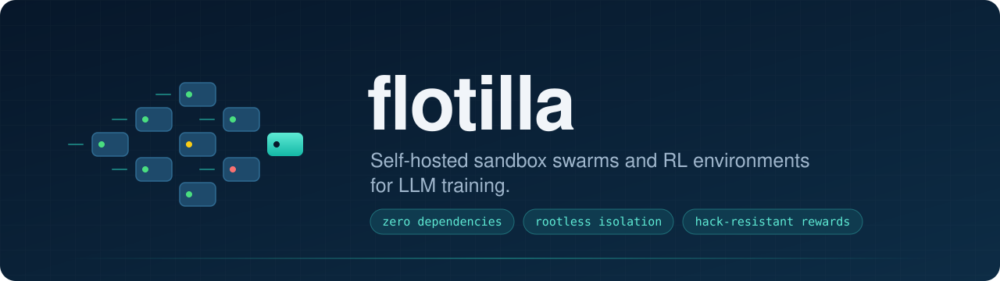
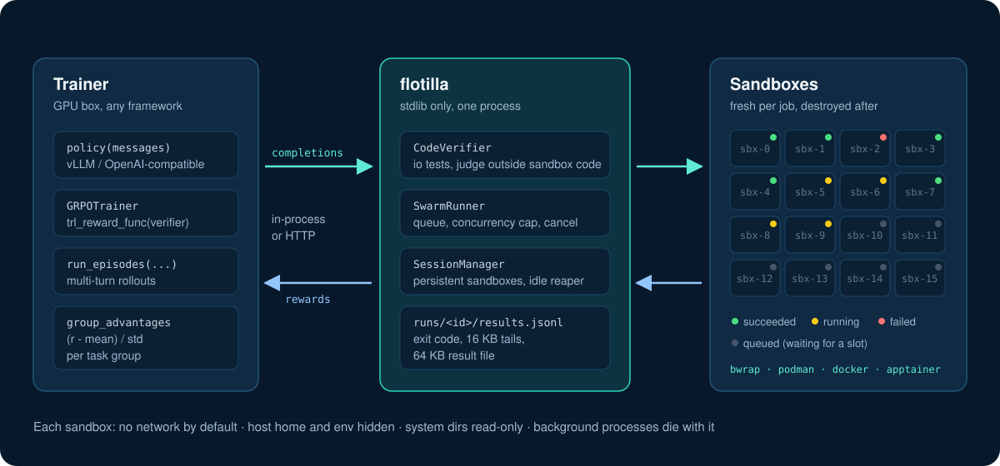
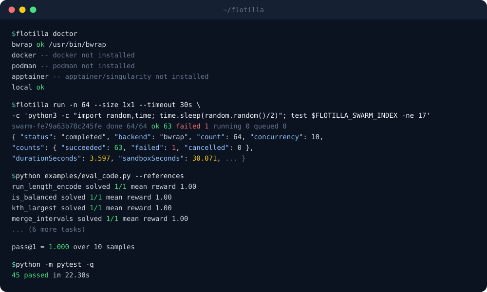

<p align="center">
  
</p>

<p align="center">
  <a href="https://github.com/Melihakbulut221/flotilla/actions/workflows/test.yml"></a>
  
  
  
  <a href="LICENSE"></a>
</p>

<p align="center">
  <a href="#quickstart">Quickstart</a> &middot;
  <a href="#swarms">Swarms</a> &middot;
  <a href="#rl-environments">RL environments</a> &middot;
  <a href="#reward-hacking-resistance">Reward hacking</a> &middot;
  <a href="#verl-and-mimo-datasets">verl</a> &middot;
  <a href="#backends-and-threat-model">Backends</a> &middot;
  <a href="#how-it-compares">Compare</a>
</p>

---

flotilla runs one command on many fresh, isolated sandboxes at once and
collects every result: exit code, output tails and a result file. On top of
that it provides what an RL loop for a language model needs, on your own
hardware, with nothing to install beyond Python and a sandbox tool most Linux
machines already have.

<table>
<tr>
<td width="33%" valign="top">

**Swarms**<br>
One command, `count` copies or one per input. Concurrency caps, timeouts,
cancel, idempotency keys, JSON Lines results in input order.

</td>
<td width="33%" valign="top">

**Verifiable code rewards**<br>
Each completion runs against tests in its own sandbox; the pass fraction
is the reward. Drops into TRL's `GRPOTrainer`.

</td>
<td width="33%" valign="top">

**Multi-turn tool use**<br>
Native function calling (bash, read, write, edit, grep, glob, submit) or
plain shell blocks in persistent sandboxes. A hidden verifier scores the
final state.

</td>
</tr>
<tr>
<td valign="top">

**Rootless isolation**<br>
Namespaces via bubblewrap: no network, host home and env hidden, read-only
system dirs. Containers and Apptainer for cgroups or HPC.

</td>
<td valign="top">

**Hack-resistant judging**<br>
The judge never shares a process or a sandbox with model code. Known
reward hacks are part of the test suite and all score 0.

</td>
<td valign="top">

**Local or remote**<br>
In-process for one box, or `flotilla serve` on a CPU host and drive it over
HTTP from the GPU trainer.

</td>
</tr>
</table>

<p align="center">
  
</p>

## Quickstart

```bash
git clone https://github.com/Melihakbulut221/flotilla && cd flotilla
pip install -e .            # no dependencies
sudo apt install bubblewrap # isolated backend; usually already present
flotilla doctor             # shows which backends work here
```

<p align="center">
  
</p>

<sub>Captured output, condensed where marked with <code>...</code>. The swarm ran
64 sandboxes on the bwrap backend at concurrency 10; sandbox 17 fails on purpose.</sub>

## Swarms

A swarm is one shell command, run either `count` times or once per entry in
`inputs`. Each sandbox is created fresh, its input files are written, and the
command runs with `FLOTILLA_SWARM_INDEX`, `FLOTILLA_SWARM_COUNT` and
`FLOTILLA_SWARM_ID` set. The same variables are also exported with a
`MARITIME_` prefix, so scripts written for hosted swarm services run
unchanged. When the command exits, flotilla keeps the exit code, the last
16 KB of stdout and stderr, and the file at `resultPath` (up to 64 KB). The
sandbox, disk included, is then destroyed.

```python
from flotilla import Flotilla

fl = Flotilla()  # in-process, best available isolated backend
run = fl.swarms.run("python3 eval.py --case $FLOTILLA_SWARM_INDEX", count=50, timeout_seconds=600)
print(run["counts"])  # {'succeeded': 48, 'failed': 2, ...}

run = fl.swarms.run(
    "python3 rollout.py",
    inputs=[
        {"args": ["--seed", "1"]},
        {"args": ["--seed", "2"], "env": {"TEMPERATURE": "0.7"}},
        {"files": {"/work/task.json": '{"id": 3}'}},
    ],
    result_path="/work/result.json",
    size="2x4",          # vCPUs x GB
    concurrency=16,
)
for sb in run["sandboxes"]:
    print(sb["index"], sb["status"], sb["exitCode"], sb["result"])
```

```
queued ──▶ booting ──▶ running ──┬──▶ succeeded   exit 0
                                 ├──▶ failed      non-zero exit, timeout or boot error (see "error")
                                 └──▶ cancelled   fl.swarms.cancel(id)
```

A run is `completed` (or `cancelled`) once every sandbox has ended.

- **Global cap:** `max_concurrency`, the number of sandboxes alive at once
  across all runs. It defaults to half the CPU count.
- **Per-run cap:** `concurrency`, clamped to the global cap.
- **CPU pinning:** each sandbox is pinned to its own `vcpus` cores while
  enough are free.
- **Persistence:** runs are saved under `~/.flotilla/runs/<id>/`.

<details>
<summary><b>CLI</b></summary>

```bash
flotilla run --count 50 --command 'python3 eval.py --case $FLOTILLA_SWARM_INDEX' --size 2x4 --timeout 10m -o results.jsonl
flotilla run --inputs inputs.jsonl --command 'python3 rollout.py' --result-path /work/result.json
flotilla list | flotilla get ID | flotilla results ID -o r.jsonl | flotilla cancel ID
```

`flotilla run` exits 0 only if every sandbox succeeded. See
[`examples/swarm_basics.sh`](examples/swarm_basics.sh).

</details>

<details>
<summary><b>Server mode and HTTP API</b></summary>

Run sandboxes on one machine and drive them from another:

```bash
FLOTILLA_TOKEN=change-me flotilla serve --host 0.0.0.0 --port 8642
```

```python
fl = Flotilla(base_url="http://sandbox-host:8642", token="change-me")
```

| Route | Purpose |
|---|---|
| `POST /api/swarms` | start a run (`Idempotency-Key` header supported) |
| `GET /api/swarms?limit=50` | list runs, newest first |
| `GET /api/swarms/{id}` | run plus every sandbox |
| `POST /api/swarms/{id}/cancel` | cancel |
| `GET /api/swarms/{id}/results` | JSON Lines, input order |
| `POST /api/sessions` | open a persistent sandbox |
| `POST /api/sessions/{id}/exec` | run a command in it |
| `PUT` / `GET /api/sessions/{id}/files` | write or read a file |
| `DELETE /api/sessions/{id}` | destroy it |

Request bodies accept these fields, in camelCase or snake_case:

- `command`
- `count` or `inputs[]`, each input with optional `args`, `env` and `files`
- `size {vcpus, memoryGb}`
- `timeoutSeconds`
- `concurrency`
- `resultPath`
- `image`
- `network`
- `env`
- `name`

The server refuses to bind a non-loopback address without a token.

</details>

## RL environments

### Verifiable code reward (single turn, GRPO)

```python
from flotilla import Flotilla
from flotilla.rl import CodeVerifier

verifier = CodeVerifier(Flotilla(), timeout=60, per_test_timeout=5)
task = {"entry_point": "add", "tests": [{"args": [1, 2], "expected": 3}, {"args": [-1, 1], "expected": 0}]}
rewards = verifier.rewards(completions, [task] * len(completions))   # floats in [0, 1]
```

The last fenced code block of each completion runs in its own sandbox. A
completion without a code block gets 0 and costs no sandbox. With TRL:

```python
from trl import GRPOTrainer
from flotilla.rl import trl_reward_func

trainer = GRPOTrainer(model=..., reward_funcs=[trl_reward_func(verifier)], train_dataset=ds, args=cfg)
```

The dataset needs `tests` and `entry_point` columns.
[`examples/train_grpo_trl.py`](examples/train_grpo_trl.py) is a complete
script, and [`examples/eval_code.py`](examples/eval_code.py) scores any
OpenAI-compatible endpoint on the example task set.

### Music with a prompt-adherence reward

```python
from flotilla.rl import MusicReward, make_music_tasks, trl_music_reward

tasks = make_music_tasks(2000, seed=1)   # "Compose a jig in D minor, 6/8 time, at dotted quarter = 80, 16 bars ..."
rewards = MusicReward().rewards(completions, tasks)
trainer = GRPOTrainer(..., reward_funcs=[trl_music_reward(MusicReward())])
```

The policy writes ABC notation. The reward is
`validity x adherence x (0.4 + 0.6 x musicality)`.

**Adherence** checks each constraint the prompt states: key, meter,
tempo, number of bars and number of voices. A header claim only counts if
the music backs it:

- `K:Dm` earns nothing for the key unless the notes fit D minor;
- `M:6/8` earns nothing for the meter unless the bars have that length.

**Musicality** is a set of corpus-free heuristics:

- scale fit;
- steps against leaps;
- range;
- rhythmic variety;
- motifs that repeat without looping;
- an ending on the tonic.

Their mean is scaled by a degeneracy gate (the worst of repeats, range,
motifs and scale fit). A drone or a loop therefore cannot score well by
collecting the easy points.

| Completion | Adherence | Reward |
|---|:-:|:-:|
| a jig that follows the prompt | 1.00 | 1.00 |
| one note held for every bar, correct header | 1.00 | 0.53 |
| correct header over notes that are not in the key | 0.80 | 0.45 |
| a fluent tune in the wrong key, meter and tempo | 0.30 | 0.29 |

These rows are the cases in [`tests/test_music.py`](tests/test_music.py).
Scorers that only measure similarity to human music statistics would rank
the last row level with the first. This is the gap the adherence term
closes.

The parser is pure Python and bounded, and it runs no code, so this
environment needs no sandbox and no `abc2midi`. `reference_piece()` writes a
plain compliant piece for any task; `eval_music.py --references` checks that
every task is solvable with full adherence. `to_midi()` turns a completion
into a MIDI file to listen to.

```bash
python examples/eval_music.py --base-url http://localhost:8000/v1 --model my-model --samples 4 --midi-dir midi/
python examples/train_grpo_trl.py --env music --model Qwen/Qwen2.5-0.5B-Instruct --max-completion-length 1024
```

#### Warm-up before RL

A 1.5B instruct model writes no valid ABC for MiMo-style prompts: reward
0.000 on 200 rows. With a format prompt it reaches 0.016, and meter and bar
adherence stay at 0. GRPO from that start has almost no signal.

`flotilla.rl.music_sft` builds a supervised set from the Nottingham folk-tune
collection: 6060 examples, English and Chinese prompts, 30 keys, one to six
voices. Every example is checked to get full adherence from the RL reward.
`examples/sft_music.py` trains a LoRA on it. On an 8 GB laptop GPU, two
epochs take 3.6 hours. The result on 200 MiMo rows:

- mean reward goes from 0.000 to **0.708**;
- valid ABC goes from 0 to 197 of 200;
- Chinese prompts score 0.89, English prompts 0.53;
- many completions imitate the synthetic examples.

```bash
python examples/build_music_sft.py --download && python examples/build_music_sft.py
python examples/sft_music.py --model Qwen/Qwen2.5-1.5B-Instruct
```

See [docs/music_sft.md](docs/music_sft.md) for the build, the statistics and
the licenses. The generated data stays out of this repository: the
Nottingham part is GPL-3.0.

### Multi-turn tool use

```python
from flotilla.rl import OpenAIChatPolicy, group_advantages, run_episodes

policy = OpenAIChatPolicy("http://localhost:8000/v1", "my-model")  # e.g. `vllm serve my-model`
trajs = group_advantages(run_episodes(fl, policy, tasks, samples_per_task=8, parallel=16))
```

```
system   You are working in a Linux sandbox ... reply with a ```bash``` block or SUBMIT.
user     /work/stats.py should print the sum of 1..100 but prints the wrong value. Fix it.
assistant  ```bash
           cat stats.py; python3 stats.py
           ```
user     total = 0 / for i in range(1, 100): ... / 4950  [exit code 0]
assistant  ```bash
           sed -i 's/range(1, 100)/range(1, 101)/' stats.py && python3 stats.py
           ```
user     5050  [exit code 0]
assistant  SUBMIT                                   -> hidden verifier runs -> reward 1.0
```

Files persist between turns. When the episode ends, the verifier does not
run in the sandbox the agent controlled:

1. The agent's working directory (`/work`, or the task's `workdir`) is packed
   and rebuilt on the host. Kept: regular files, directories, and relative
   symlinks that stay inside the directory. Dropped: absolute or escaping
   links, devices, and absolute or `..` paths.
2. A **fresh sandbox** is opened from the same image. The task's input files
   outside the working directory are written again unmodified, `setup` runs
   again, and then the optional `verify_prepare` runs.
3. The working directory is emptied and replaced by the agent's snapshot, so
   files the agent deleted stay deleted.
4. The hidden `verify_files` are written and `verify` runs:
   - exit 0 gives reward 1, anything else gives 0;
   - if the **last** line of stdout is `FLOTILLA_REWARD=<float>`, that value
     is the reward instead (partial credit). A marker printed earlier, for
     example by agent code the tests ran, is ignored.

Overwriting a reference file, planting something in `/tmp`, or leaving a
module for the verifier to import therefore has no effect. Deliverables must
live in the working directory. Use `isolated_verify=False` only for tasks
whose result is state outside it.

Tasks can also set `image`, `size` and `verify_timeout`. File contents may be
text or `{"base64": "..."}`.

### Tool-calling agents

`ToolTaskEnv` gives the policy real functions instead of text conventions,
the same shape coding agents use in production:

| Tool | What it does |
|---|---|
| `bash(command, timeout?)` | runs in `/work`, no network; returns output and exit code |
| `read(path, offset?, limit?)` | numbered lines, 500 by default |
| `write(path, content)` | creates parent directories |
| `edit(path, old_string, new_string, replace_all?)` | exact replacement; refuses an ambiguous match |
| `grep(pattern, path?, glob?, ignore_case?)` | `path:line:text` matches |
| `glob(pattern, path?)` | `**/*.py` style file listing |
| `submit(summary?)` | ends the episode and runs the verifier |

```python
from flotilla.rl import OpenAIToolPolicy, ToolTaskEnv, run_episodes

# vllm serve my-model --enable-auto-tool-choice --tool-call-parser hermes
policy = OpenAIToolPolicy("http://localhost:8000/v1", "my-model")
trajs = run_episodes(fl, policy, tasks, samples_per_task=8, env_cls=ToolTaskEnv)
```

Three call encodings are accepted:

- native `tool_calls` from the server;
- Hermes `<tool_call>{"name": ..., "arguments": ...}</tool_call>` in the
  text;
- Qwen3-Coder `<tool_call><function=...><parameter=...>` XML in the text.

The text encodings let a model served without a tool parser be trained the
same way: pass `native_tools=False` and the schemas are rendered into the
system prompt.

Episodes and turns:

- Each assistant message is one turn, with at most
  `max_tool_calls_per_turn` calls.
- Long results are cut in the middle, so both the head and the tail of a
  traceback stay visible.
- A malformed call is answered with an error and counted in
  `info["tool_errors"]`, which you can penalise. Examples are an unknown
  tool, invalid JSON, a missing argument, or a write to a read-only dir.
- The episode ends on `submit`, on a turn without any tool call, or at
  `max_turns`. Verification is the isolated kind described above.

### Training signal hygiene

```python
from flotilla.rl import filter_groups, group_advantages, length_penalty

trajs = run_episodes(fl, policy, tasks, samples_per_task=8)
trajs = group_advantages(length_penalty(trajs))
batch, stats = filter_groups(trajs)
# stats: groups, kept_groups, uniform_groups, too_few_valid, infra_rollouts
```

- **Infra errors are not policy failures.** A sandbox that fails to boot or
  a model server that times out flags the rollout `infra_error` instead of
  scoring it 0. Flagged rollouts get advantage 0 and are left out of their
  group's mean and std, so a flaky node cannot push the rest of the group's
  advantages around.
  - `CodeVerifier.score()` marks the same cases with `Score.infra`.
  - `rewards()`, for trainers that cannot mask samples, substitutes
    `infra_reward`.
- **Groups with no signal are dropped.** If every valid rollout in a group
  scored the same, the group contributes zero gradient. `filter_groups`
  removes these groups and reports how many there were.
- **Degenerate repetition scores 0.** Long text whose word 4-gram
  uniqueness falls below 0.15 is scored 0. The check runs after verification
  and before any group step, so nothing later can overwrite it.
- **Length penalty.** When most of a group passes, longer passing rollouts
  lose up to 0.2, scaled linearly from the group's 30th-percentile length to
  the longest. On hard tasks, where few pass, nothing is penalised.

See [`examples/tasks/shell_tasks.jsonl`](examples/tasks/shell_tasks.jsonl) for
the task format, and run
[`examples/shell_agent_rollouts.py`](examples/shell_agent_rollouts.py)
`--scripted` for a dry run that needs no model.

## Reward hacking resistance

A policy under RL pressure will find any shortcut to a high reward. In `io`
mode (tests given as `args`/`expected` pairs), the model's code runs in a
child process that only receives the inputs. The judge is a separate
process that holds the expected values.

| Attack in the submitted code | What stops it | Reward |
|---|---|:-:|
| `os._exit(0)` before any test runs | pass/fail comes from compared outputs, not exit codes | 0 |
| print a fake "all passed" result | the solution's stdout is redirected away from the protocol channel | 0 |
| read the expected answers from disk | the task file is deleted before the child starts; the judge is non-dumpable | 0 |
| return an object whose `__eq__` is always true | outputs are JSON-serialised before comparison | 0 |
| fork a daemon that overwrites the result file later | the judge is a child subreaper and kills every descendant before writing | 0 |

For multi-turn tasks, the verifier runs in a separate sandbox:

| Attack by the agent | What stops it | Reward |
|---|---|:-:|
| overwrite the reference answer the verifier compares against | the verifier gets a fresh sandbox, with task inputs restored | 0 |
| plant files in `/tmp` or outside `/work` for the verifier to pick up | only `/work` is carried over | 0 |
| symlink a workspace file to a path outside `/work` | links are dropped when the workspace is rebuilt | 0 |

Each row is a test in [`tests/test_rl.py`](tests/test_rl.py) or
[`tests/test_shaping.py`](tests/test_shaping.py). Two attacks were also run
with the protection switched off, and both scored 1.0 there: the late-writer
daemon (code verifier) and the reference overwrite (multi-turn). So those
tests prove the protections work. `assert` mode (tests as Python source) is also
supported for convenience, but it shares a process with the solution. Prefer
`io` mode for training.

## verl and MiMo datasets

`flotilla.verl` converts between flotilla tasks and [verl](https://github.com/volcengine/verl)
RL rows, and gives verl a reward function backed by flotilla.

```bash
pip install pyarrow                                   # only for .parquet; .jsonl needs nothing
flotilla verl export --kind code examples/tasks/code_tasks.jsonl -o code_train.parquet
flotilla verl export --kind music examples/tasks/music_tasks.jsonl -o music_train.parquet
```

```bash
python -m verl.trainer.main_ppo \
  data.train_files=code_train.parquet \
  custom_reward_function.path=$(python -c "import flotilla.verl as v; print(v.__file__)") \
  custom_reward_function.name=compute_score_batch reward_model.reward_manager=batch ...
```

The `custom_reward_function.*` and `reward_model.reward_manager` keys are
the ones in verl's PPO trainer config. Check them against the verl version
you run, since verl config keys move between releases.

Row schema:

- `prompt` is a chat message list.
- `reward_model.ground_truth` is a JSON string, so every row has the same
  Parquet schema.
- `extra_info.task_json` carries the full task, so an export can be
  imported back unchanged.

Scoring:

- `compute_score` is the per-sample entry point; `compute_score_batch` is
  for the batch reward manager.
- With `compute_score_batch`, every code completion in a batch runs in one
  swarm.
- Every flotilla result is `{"score", "infra"}`.
- Other `data_source` values fall back to verl's own `default_compute_score`.

`flotilla verl import` reads rows from
[MiMo-V2.6-RL-oss](https://huggingface.co/datasets/XiaomiMiMo/MiMo-V2.6-RL-oss), as
Parquet, JSON Lines or a datasets-server JSON dump, and writes one
`<kind>.jsonl` file per kind:

| MiMo split | Becomes | What it needs |
|---|---|---|
| `music` | a music task; tempo, meter and voices come from `extra_info`, key and bar count are parsed from the Chinese or English prompt | nothing (no Docker) |
| `general` (`terminal_bench`) | a tool task on the row's image; `tests_files` are written at verification and `reward.txt` is the reward | a container backend |
| `code` (`opensource-code`) | a tool task on the row's image; files touched by the hidden test patch are restored from the image, then the patch is applied and `test_command` runs | a container backend |
| `cyber`, `webdev` | skipped, with a reason | an in-image grading server, or a browser and a vision judge |

The MiMo music scorer does not read these constraints, so the import is what
makes them gradable. For the code split, restoring the touched files does
two jobs:

- an always-passing test the agent planted is replaced;
- an honest agent that edited a test file while working still has the hidden
  patch apply.

`tests/test_verl.py` shows both, including that the same honest fix scores 0
without the restore.

Image references point at Docker Hub's `xiaomimimo/mimo-v2.6-rl-oss`. The
mapping from the rows' bare image names to its tags is inferred from that
repository's tag list; the dataset does not document it. Pass `--apptainer`
for `docker://` references on HPC. The image-based imports were tested on
bwrap, with the image's state recreated by `setup`; they have not been run
against the real images.

## Backends and threat model

| Backend | Isolation | Needs | Notes |
|---|---|---|---|
| `bwrap` (default) | user/pid/net/ipc/uts namespaces, empty tmpfs root, read-only system dirs, host home hidden, no network | `bubblewrap`, unprivileged user namespaces | ~120 ms per sandbox, ~80 sandboxes/s on a 20-core workstation |
| `podman` / `docker` | containers with cgroup CPU, memory and pid limits; any image | a container engine | `image=` picks the toolchain |
| `apptainer` | containers on HPC clusters without root | `apptainer` / `singularity` | state kept in staged host dirs |
| `local` | none | nothing | development only, never for untrusted model output |

[`tests/test_isolation.py`](tests/test_isolation.py) checks what the `bwrap`
backend guarantees:

- the host home directory, dotfiles and keys are invisible;
- host environment variables do not leak in;
- there is no network unless you ask for it;
- system dirs are read-only;
- a symlink planted in the sandbox cannot make the host read or write host
  files;
- background processes die with the sandbox;
- each sandbox has its own pid namespace.

The `bwrap` backend has three limits:

- It shares the kernel with the host, because it is a namespace sandbox and
  not a VM. That is a sound trade-off for scoring your own model's code on
  your own machine. For hostile multi-tenant code, use a VM-based sandbox.
- Memory is capped with `RLIMIT_AS` and CPU by core pinning.
- The process count is not capped, since cgroups need root.

The Docker, Podman and Apptainer backends use the engines' standard CLIs.
CI covers `bwrap` and `local`.

## How it compares

|  | Hosted micro-VM swarm services | flotilla |
|---|---|---|
| Isolation | a VM per sandbox (stronger) | namespaces or containers |
| Cost | billed per vCPU-second and GB-second | your own hardware |
| Parallelism | set by the plan | set by your cores |
| Per-sandbox lifecycle | one command, then destroyed | one command (swarms) or many turns (sessions) |
| Rewards and verifiers | left to your command | code verifier, shell task env, TRL adapter |
| Setup | an API key | `pip install -e .` |

## Layout

```
flotilla/spec.py        request model and validation
flotilla/swarm.py       swarm runner: queue, concurrency, cancel, persistence, idempotency
flotilla/session.py     persistent sandboxes for multi-turn environments
flotilla/backends/      bwrap, docker/podman, apptainer, local
flotilla/server.py      HTTP API (stdlib)
flotilla/client.py      one client for in-process and remote use
flotilla/verl.py        verl row export/import, MiMo import, verl reward functions
flotilla/rl/            code verifier, music scorer and SFT builder, shell and tool-calling envs, rollouts, reward shaping, TRL adapters
examples/               task sets, eval, GRPO training, rollout collection
tests/                  swarm, isolation, reward-hacking, shaping, tool-calling, music, verl and server tests
```

## Tests

```bash
pip install pytest && python3 -m pytest -q
```

## License

[Apache-2.0](LICENSE)
